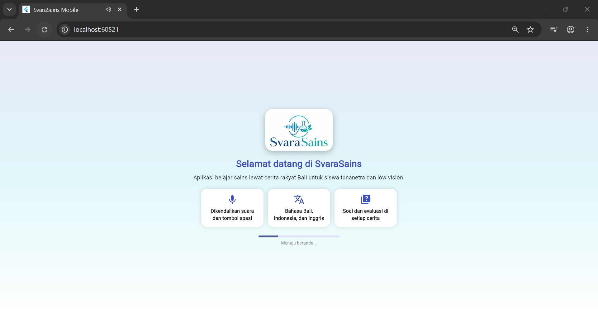
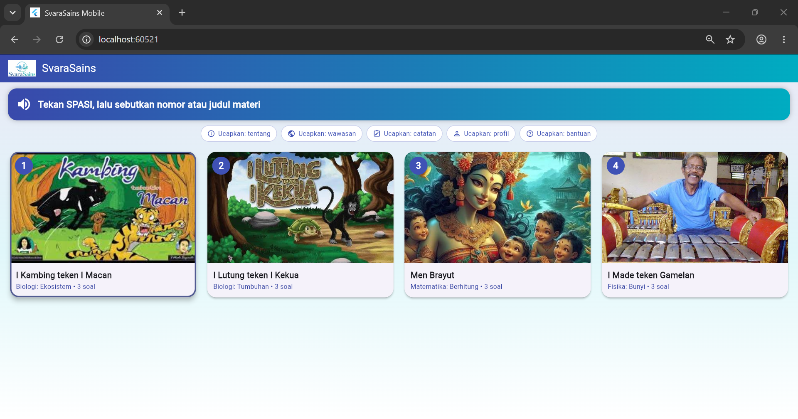
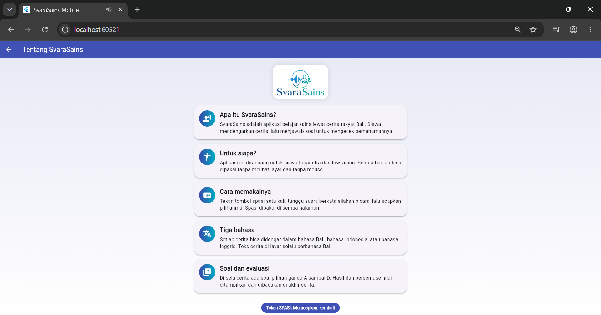
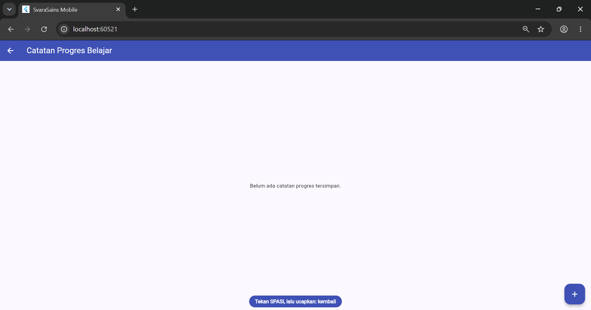
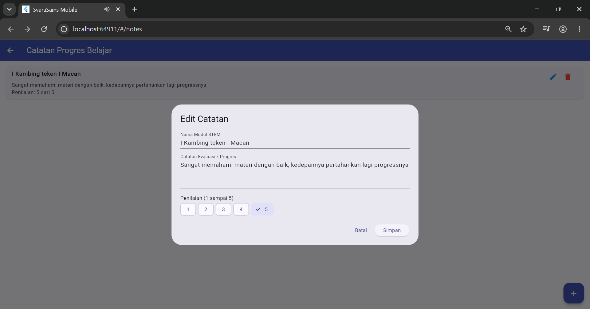
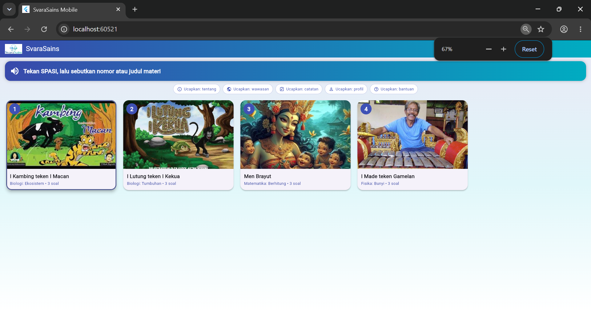
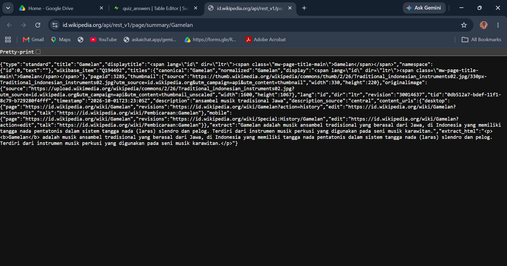
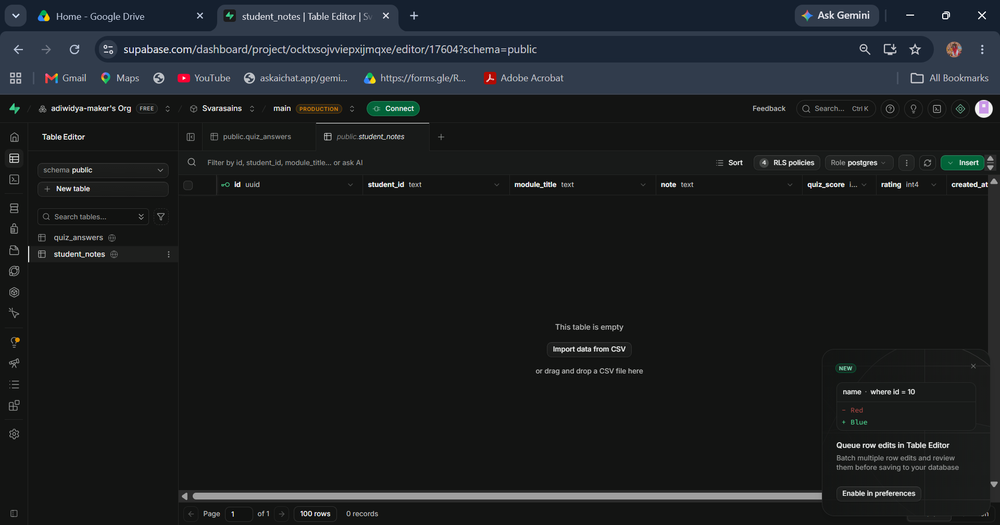

# SvaraSains Mobile

Aplikasi belajar sains (STEM) lewat cerita rakyat Bali untuk siswa tunanetra dan low vision.
Seluruh aplikasi dikendalikan dengan suara dan tombol spasi, tanpa mouse.

Project UTS Pemrograman Mobile, tema: *SvaraSains: Akselerasi Pembelajaran STEM Berdiferensiasi Berbasis Asistif Auditori Bagi Siswa Tunanetra SLB Negeri 1 Buleleng*.

## Identitas

- Nama: I Gede Adiwidya Utama
- NIM: 2415051001
- Kelas: 5IKI-PTI

## Fitur

- Sambutan suara otomatis dan panduan di setiap halaman
- 4 materi cerita rakyat Bali (Biologi, Matematika, Fisika)
- Narasi dalam bahasa Bali, Indonesia, dan Inggris; subtitle tetap Bali
- Perintah suara: tekan spasi, lalu ucapkan pilihan
- Soal pilihan ganda di sela cerita, evaluasi dan persentase di akhir
- Catatan belajar (CRUD) tersimpan di database
- Artikel sains dari REST API
- Loading, error, dan empty state
- Tata letak responsif (compact dan wide)

## Tech Stack

| Bagian | Teknologi |
|---|---|
| Framework | Flutter, Dart |
| State management | Provider (ChangeNotifier) |
| Backend dan database | Supabase (PostgreSQL) |
| Suara | flutter_tts (teks ke suara), speech_to_text (suara ke teks) |
| Animasi | flutter_animate |

## REST API

**Wikipedia REST API** (bahasa Indonesia)
URL dasar: `https://id.wikipedia.org/api/rest_v1`

- Operasi: `GET /page/summary/{judul_topik}`
- Contoh: `GET https://id.wikipedia.org/api/rest_v1/page/summary/Gamelan`
- Lima topik sains tersedia: Gamelan, Bunyi, Getaran, Gelombang, dan Cahaya. Pengguna memilih salah satu, lalu aplikasi memanggil endpoint untuk topik itu
- Dipanggil oleh `ScienceApiService.fetchSummary(topic)`, dengan judul topik di-encode dan batas waktu 10 detik
- Response JSON dikonversi ke model `ScienceArticle` (`title`, `extract`, `thumbnail.source`, `content_urls.desktop.page`) dan ditampilkan sebagai artikel sains pada aplikasi
- State dikelola `ScienceProvider`:

| Kondisi | State |
|---|---|
| Permintaan berjalan | loading |
| Artikel berhasil dimuat | loaded |
| Kode 404 atau ringkasan kosong | empty |
| Timeout atau kegagalan lain | error, dengan pesan untuk mencoba lagi |

## Backend dan Database

Supabase (PostgreSQL)

**Tabel `student_notes`** (catatan belajar, mendukung CRUD)

| Kolom | Keterangan |
|---|---|
| id | primary key |
| student_id | identitas siswa |
| module_title | judul materi |
| note | isi catatan |
| quiz_score | skor kuis |
| rating | penilaian siswa |
| created_at | waktu dibuat |

**Tabel `quiz_answers`** (jawaban kuis)

| Kolom | Keterangan |
|---|---|
| id | primary key |
| student_id | identitas siswa |
| story_id | cerita yang dikerjakan |
| question_index | nomor soal |
| chosen_index | pilihan yang dipilih |
| language | bahasa yang dipakai |
| created_at | waktu dibuat |

Aplikasi hanya memakai `anon` key. Tidak ada `service_role` key di dalam kode.

## Arsitektur

Alur: UI → Provider → Repository → Service → REST API / Database.
Screen tidak mengakses HTTP atau database secara langsung.

```
lib/
├── config/        konfigurasi aplikasi
├── models/        Story, Question, ScienceArticle, StudentNote
├── services/      speaker (TTS), voice_input (STT), API dan Supabase
├── repositories/  akses data kuis
├── providers/     NoteProvider, ScienceProvider
├── screens/       halaman aplikasi
├── widgets/       komponen yang dipakai ulang (VoicePage)
└── main.dart
```

## Screenshot
| Home | List | Detail |
|---|---|---|
|  |  |  |

| Create | Edit | Responsif (lebar) |
|---|---|---|
|  |  |  |

| Data API | Data Database |
|---|---|
|  |  |

## Cara Menjalankan

Persyaratan: Flutter SDK terpasang, Chrome (atau emulator/perangkat Android), dan project Supabase.

1. Clone repository:
   ```
   git clone https://github.com/adiwidya-maker/UTS_2415051001_IGedeAdiwidyaUtama.git
   cd UTS_2415051001_IGedeAdiwidyaUtama
   ```
2. Pasang dependensi: `flutter pub get`
3. Isi URL dan anon key Supabase di `lib/config/app_config.dart`
   (jangan memakai service_role key)
4. Jalankan skema SQL (tabel `student_notes` dan `quiz_answers`) di Supabase SQL Editor
5. Jalankan aplikasi: `flutter run -d chrome`

## APK

[ISI: link Google Drive APK `https://drive.google.com/file/d/1ZS6EWMQIgU74YlAjosg3EbDWAhWSax_Q/view`]